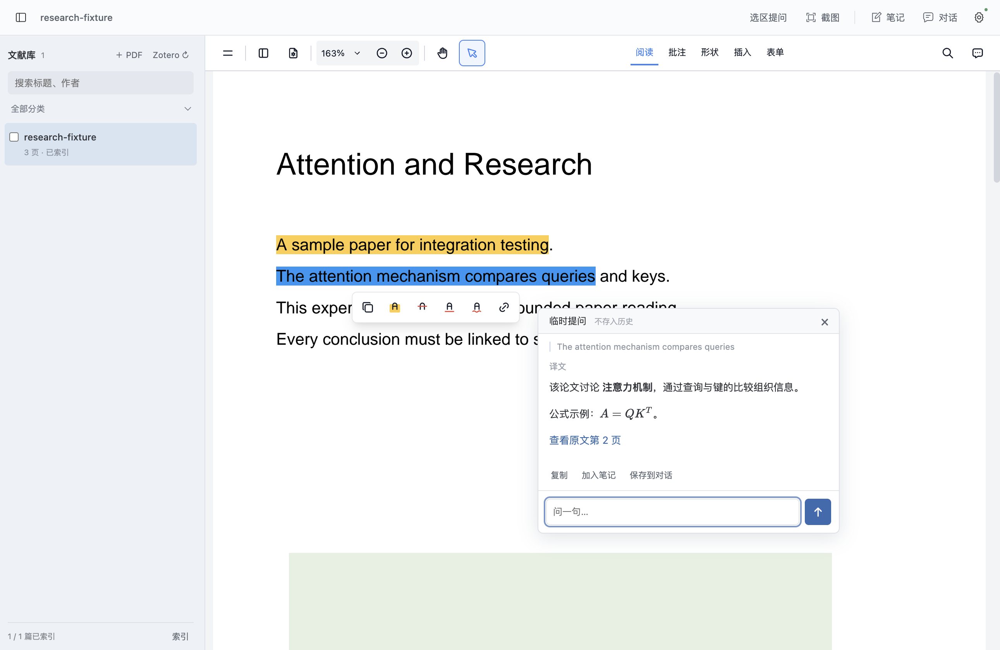

# Flow Paper

[中文](README.md) · [Download for Apple Silicon](https://github.com/xyizhan/flow-paper/releases/tag/v0.2.0-beta.1)

An independent macOS paper reader with contextual AI chat, built on [LLM for Zotero](https://github.com/yilewang/llm-for-zotero) and [EmbedPDF](https://github.com/embedpdf/embed-pdf-viewer). Organize papers in Zotero; read, annotate and discuss them in Flow Paper.

- Select text or capture a figure for a temporary conversation next to the paper. Nothing is saved to chat history unless explicitly retained.
- Dock persistent chat on the right or pop it into a separate native window. Drag its six-dot handle to the reader's right edge and release over the preview to dock. Drafts, attachments and active streams survive the move.
- Compare selected papers or search the indexed library, with page links back to evidence.
- PDF tabs, highlights, annotations, Markdown notes and export. Local PDF rendering and text extraction.
- Read-only local Zotero integration, plus direct PDF import. Configure your own model service; no API keys are bundled.



## Install

The first public preview, `0.2.0-beta.1`, targets Apple Silicon Macs. The bundle requires macOS 13 or later; local validation was performed on macOS 26.5. Intel, Windows and Linux installers are not provided.

Download the DMG from [Releases](https://github.com/xyizhan/flow-paper/releases/tag/v0.2.0-beta.1), then drag **Flow Paper.app** into Applications. An app ZIP, source ZIP including the pinned upstream trees, and checksums are also provided. This preview is ad-hoc signed, **not** Developer ID signed or notarized. Use macOS **System Settings → Privacy & Security → Open Anyway** if the system blocks it. Do not disable Gatekeeper or SIP. See [installation](docs/INSTALL.md).

The current interface and detailed user documentation are in Chinese. Model replies can be requested in any language.

## Build

```sh
git clone https://github.com/xyizhan/flow-paper.git
cd flow-paper
git submodule update --init
npm ci
npm start
npm run verify
npm run package:mac
npm run release:mac
```

Use Node.js 24. Packaging requires an Apple Silicon Mac and Xcode Command Line Tools. Our additional release source ZIP includes the upstream trees; GitHub's automatic source ZIP does not.

Ordinary tests use generated PDFs and a loopback mock service, with real Electron, PDFium and upstream streaming code. They do not contact paid models. See [validation](docs/VALIDATION.md) and [releasing](docs/RELEASING.md).

## Privacy and scope

Original PDFs and the Zotero database are not modified. Annotations, notes and persistent chats live in your local workspace. Sending a question transmits selected context and images to your configured model service. API keys are encrypted with Electron safeStorage. Optional Codex authentication uses an existing local auth file through upstream code and may refresh it. No built-in analytics or auto-updater. See [privacy](docs/PRIVACY.md).

Library chat uses BM25 retrieval within a context budget, not exhaustive reading of every paper. Paperlib, group libraries, OCR, Zotero annotation sync and autonomous review agents are not implemented. The source retains upstream modules but does not claim to expose every upstream feature.

Licensed under **AGPL-3.0-or-later**. See [third-party notices](THIRD_PARTY_NOTICES.md). Flow Paper is an independent integration, not an official Zotero, LLM for Zotero or EmbedPDF product.
