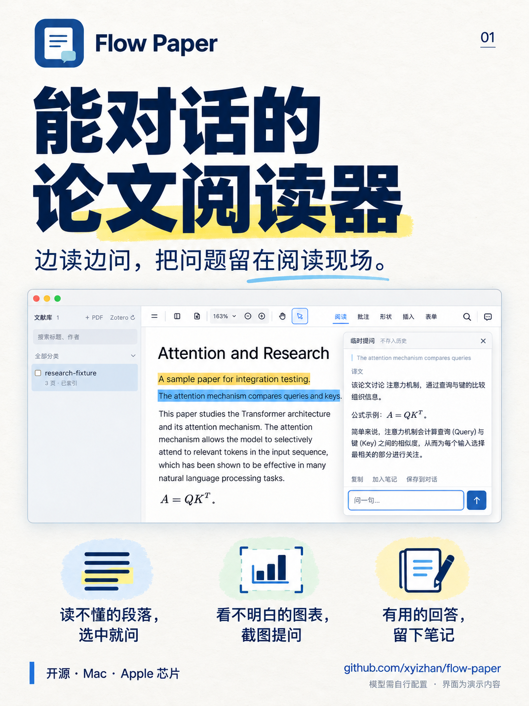
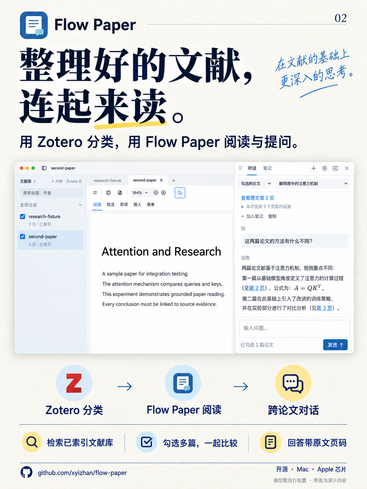

# Flow Paper 小红书海报

最新功能配图：[Obsidian 论文笔记联动 · 两页海报与三张真机截图](obsidian-notes/README.md)。

两张 1086 × 1448（3:4）竖版 PNG，可按 01 → 02 的顺序用于图文发布。点击图片可查看和下载原图。

| 01 · 能对话的论文阅读器 | 02 · 整理好的文献，连起来读 |
| --- | --- |
|  |  |

第一张介绍阅读时的选句提问、图表问答和笔记。第二张介绍 Zotero 分类接入、已索引文献库检索、多篇论文比较与原文页码引用。Flow Paper 读取 Zotero 的现有分类，整理工作仍在 Zotero 中完成。

海报基于 Flow Paper 的实际界面截图生成排版与交互示意；论文和模型回复使用合成演示内容，不含个人文献库、模型凭证或私人对话。

使用内置 image_gen 生成，完整提示词及输入素材说明见 [prompts.json](prompts.json)。图标沿用项目的 [Flow Paper 图标](../../../assets/icon.png)，临时对话参考 [原始演示截图](../../assets/quick-chat.png)，另外两张输入截图保存在 references 目录。海报中的窗口布局为视觉示意，实际界面以应用为准。

下载软件：[GitHub Releases](https://github.com/xyizhan/flow-paper/releases/tag/v0.2.0-beta.2)。模型需要自行配置；截图问答需使用支持图像的模型。
