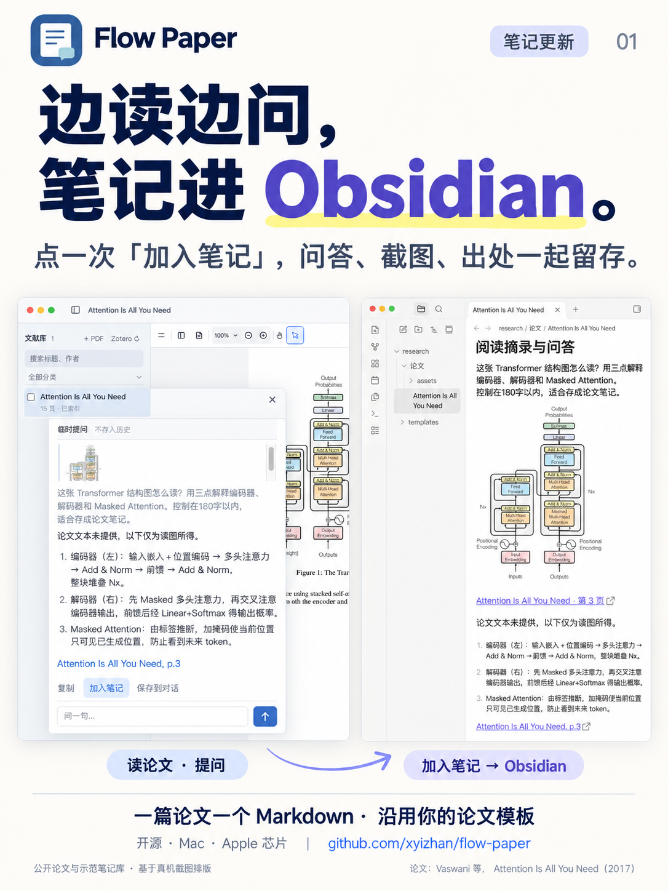
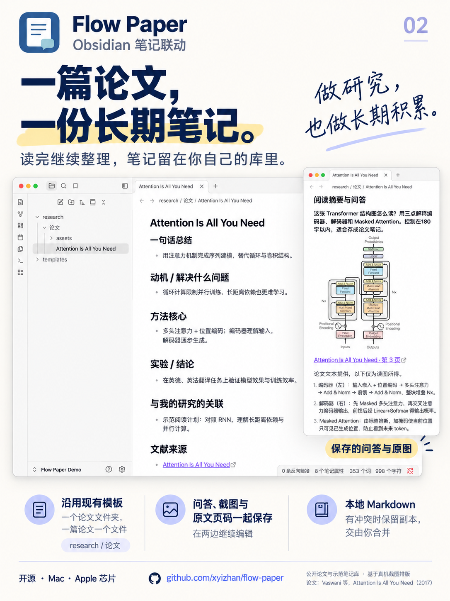

# Flow Paper × Obsidian：论文笔记更新

两页 1086 × 1448（3:4）海报，以及三张未经重绘的真机原图。建议按海报 01 → 02 → 真机截图的顺序发布。

| 01 · 边读边问，笔记进 Obsidian | 02 · 一篇论文，一份长期笔记 |
| --- | --- |
|  |  |

## 真机使用截图

这些是本机实际运行的 Flow Paper 0.3.0-beta.2 与 Obsidian 窗口截图，没有使用生成模型重绘，也没有用网页仿制应用界面。下载原图可以直接作为额外配图。

1. [Flow Paper：阅读结构图、提问与加入笔记](screenshots/01-flow-paper-question.png)（2560 × 1680）
2. [Obsidian：论文文件夹与模板笔记](screenshots/02-obsidian-paper-note.png)（2360 × 1720）
3. [Obsidian：保存的截图、问答与原文页码](screenshots/03-obsidian-saved-answer.png)（2360 × 1720）

示范论文为 Vaswani 等人的 [Attention Is All You Need（2017）](https://arxiv.org/abs/1706.03762)，图示来自原文第 3 页。论文及图示版权归原作者；在此用于说明论文阅读与笔记保存流程。

## 示范过程与隐私

- 使用独立的 Flow Paper 文献库和名为 **Flow Paper Demo** 的 Obsidian 库，只导入上述公开论文，未使用个人文献列表或私人笔记截图。
- 通过 Flow Paper 的截图提问功能调用已配置模型，等待真实回答完成后点击「加入笔记」。问答、PNG 图片与原文第 3 页链接实际写入 `research/论文/Attention Is All You Need.md`。
- 模板的总结、动机、方法等条目由人工根据公开论文整理为示范内容；产品不会自动填写整份论文总结。
- 在 Obsidian 中打开同一文件，并用 Obsidian 图片宽度语法调整示范图片显示尺寸，便于同屏查看图文。确认 Flow Paper 随后读到了这项外部修改。
- 公开素材不包含个人电脑用户名、私人路径、私人文献分类、私人对话、模型账号或 API 密钥。演示配置、PDF 和应用数据均未提交到仓库。

海报是内置 **image_gen** 基于上述截图生成的视觉排版，截图在海报中可能有裁切、缩放和重绘；实际界面以单独提供的真机原图为准。完整提示词和素材映射见 [prompts.json](prompts.json)。

## 可配发布文案

**标题：读论文问过的问题，终于能留在 Obsidian 里了**

最近给 Flow Paper 加上了 Obsidian 笔记联动。阅读时选一句话提问，或者截下一张图，让模型解释；觉得有用，就点「加入笔记」。问题、回答、截图和原文页码一起保存到论文文件夹，一篇论文一个 Markdown 文件。

可以继续用自己的论文模板，也能回到 Obsidian 补充思考。两边同时改到同一份笔记时，会保留冲突副本，交给自己合并。

这次用《Attention Is All You Need》做了完整示范，后面附了真实应用截图。

项目开源，适配 Apple 芯片 Mac。模型需要自行配置；截图问答需要支持图像的模型。

`#论文阅读 #Obsidian #论文笔记 #科研工具 #开源软件 #Mac软件`

下载：[Flow Paper v0.3.0-beta.2](https://github.com/xyizhan/flow-paper/releases/tag/v0.3.0-beta.2)。项目：[xyizhan/flow-paper](https://github.com/xyizhan/flow-paper)。
